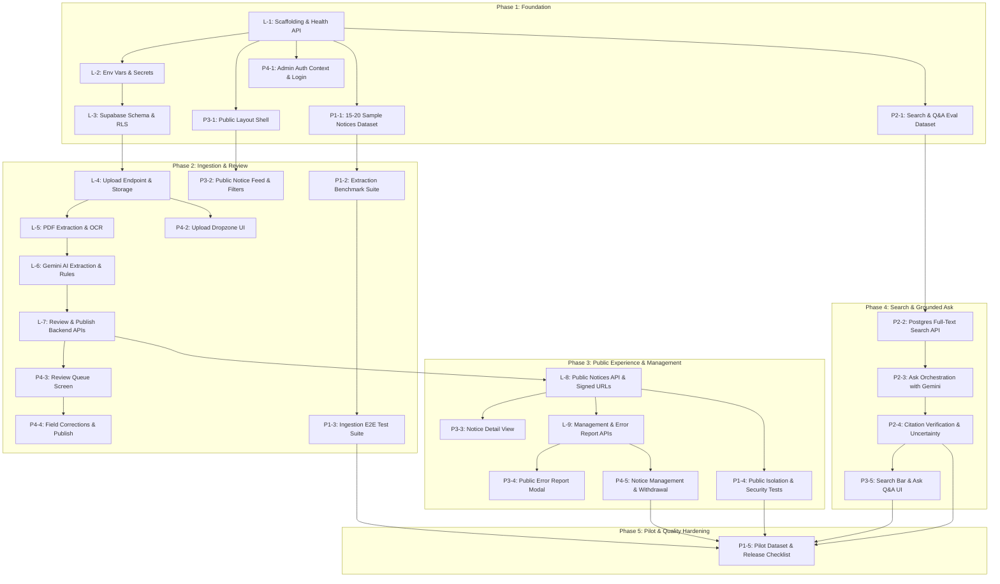

# Master Project Issues & Requirements Breakdown

**Project:** CAI Campus Intelligence — Centre for Artificial Intelligence, Kirori Mal College  
**Purpose:** Canonical catalog of all GitHub issues, branch names, assigned owners, dependencies, requirements, and deliverables across Phases 1 through 5.  
**Source of Truth:** Aligned with `PRD.md`, `TECH_STACK.md`, `SYSTEM_ARCHITECTURE.md`, `DATABASE_SCHEMA.md`, `API_CONTRACTS.md`, `MODULES.md`, `DEVELOPMENT_OWNERSHIP.md`, and `PHASE.md`.

---

## Team Roster & Ownership Summary

| Role | Accountable Owner | Focus Area | Total Issues |
|---|---|---|---|
| **Project Lead** | Lead (You) | Architecture, Scaffolding, Backend Pipeline, DB/RLS, Security, Review & Approval | 9 Issues |
| **Member 1 (P1)** | Quality & Test Assets | Sample notice collection, ground truth datasets, test automation, evaluation suites | 5 Issues |
| **Member 2 (P2)** | Search & Q&A Backend | Eval benchmark dataset, PostgreSQL full-text search, Gemini Ask pipeline, citation validation | 4 Issues |
| **Member 3 (P3)** | Public Frontend | Layout shell, notice feed/filters, detail view, error-reporting modal, search & Ask UI | 5 Issues |
| **Member 4 (P4)** | Uploader/Admin Frontend | Auth/login UI, upload dropzone, review & exception queue, correction & publish actions, notice management | 5 Issues |
| **Total** | | | **28 Issues** |

---

## 👑 Project Lead (You) — Issues & Requirements

### Issue L-1: Project Scaffolding, Base Config & Health Check API
- **Phase:** Phase 1
- **Branch:** `setup/project-scaffold`
- **Modules Covered:** M13 (Shared Platform)
- **Requirements & Prerequisites:**
  - Python 3.11+, Node.js 18+, Git installed locally.
  - Set up root repository layout: `backend/`, `frontend/`, `tests/`, `docs/`.
  - Create root `.gitignore` ignoring `.env`, `node_modules/`, `dist/`, `__pycache__/`, `.pytest_cache/`, `venv/`.
  - Backend: FastAPI skeleton with CORS configured for `http://localhost:5173`, request validation error handling, and `GET /api/v1/health` returning `{"status": "healthy", "timestamp": "...", "version": "1.0.0"}`.
  - Frontend: Vite + React + TypeScript + Tailwind CSS skeleton with path aliases (`@/` -> `src/`) and API client configured for `http://localhost:8000/api/v1`.
- **Deliverables:** Working backend running on port 8000 and frontend running on port 5173 verifying end-to-end connectivity.

### Issue L-2: Environment Variables, Secrets & Configuration Loader
- **Phase:** Phase 1
- **Branch:** `setup/env-config-baseline`
- **Modules Covered:** M03 (Auth), M13 (Shared Platform)
- **Requirements & Prerequisites:**
  - Strict compliance with `AGENTS.md` Section 8 (Security). Real credentials must never be committed.
  - Create `backend/.env.example` with blank placeholders: `GEMINI_API_KEY`, `SUPABASE_URL`, `SUPABASE_SERVICE_ROLE_KEY`, `SUPABASE_ANON_KEY`, `ENVIRONMENT`.
  - Create `frontend/.env.example` with `VITE_API_BASE_URL` and `VITE_SUPABASE_URL` / `VITE_SUPABASE_ANON_KEY`.
  - Implement Pydantic Settings model in `backend/app/core/config.py` validating that required keys are present at startup.
- **Deliverables:** Tested configuration loader rejecting invalid/missing environment configurations without leaking secrets.

### Issue L-3: Supabase Database Schema, Migrations & Row Level Security (RLS)
- **Phase:** Phase 1
- **Branch:** `feat/db-migrations-schema`
- **Modules Covered:** M07 (Notice Data), M03 (Auth)
- **Requirements & Prerequisites:**
  - Read `DATABASE_SCHEMA.md`.
  - SQL migration script establishing:
    1. `profiles` table (linked to `auth.users`) with role `uploader` or `admin`.
    2. `notices` table with distinct status dimensions: `processing_status` ('pending', 'processing', 'completed', 'failed'), `publication_status` ('held', 'published', 'withdrawn'), and `audience` ('student', 'faculty', 'staff', 'all', 'unspecified').
    3. `notice_pages` and `notice_chunks` tables for page-aware extraction.
    4. `notice_relationships` table.
    5. `error_reports` table.
  - **Critical Security:** Enable RLS on all application tables. Revoke direct SELECT/INSERT/UPDATE from `anon` and `authenticated` Supabase roles because all reads/writes must go through FastAPI using the service role key.
- **Deliverables:** Repeatable migration file `backend/migrations/001_initial_schema.sql` applied and verified.

### Issue L-4: File Storage Bucket & Authorized Upload Endpoint
- **Phase:** Phase 2
- **Branch:** `feat/upload-endpoint-storage`
- **Modules Covered:** M04 (Upload & File Management), M03 (Auth)
- **Requirements & Prerequisites:**
  - Supabase Storage private bucket `notice-originals`.
  - `POST /api/v1/notices/upload` endpoint accepting `multipart/form-data`.
  - Validate file MIME type (`application/pdf`) and magic bytes (PDF header `%PDF-`).
  - Enforce maximum file size (10MB) and maximum page count (10 pages).
  - Store original file safely using a UUID-based path; never user-supplied paths.
  - Insert initial record into `notices` table with `processing_status: 'pending'`, `publication_status: 'held'`.
- **Deliverables:** Working upload endpoint returning `202 Accepted` with `notice_id` and initial processing status.

### Issue L-5: Page-Aware Digital PDF Extraction & Scanned Notice OCR Path
- **Phase:** Phase 2
- **Branch:** `feat/text-extraction-ocr`
- **Modules Covered:** M05 (Text Extraction & OCR)
- **Requirements & Prerequisites:**
  - Integrate PyMuPDF (`fitz`) for digital text extraction.
  - Extract text page by page, preserving page numbering (`page_number: 1, 2, ...`).
  - Calculate extracted character count per page to detect scanned/empty pages (<50 characters).
  - For scanned pages, attempt fallback best-effort multimodal OCR via Gemini.
  - If OCR is unavailable, times out, or fails, mark notice as requiring human review (`hold_reason: 'ocr_uncertain_or_unreadable'`).
  - Store extracted page records in `notice_pages`.
- **Deliverables:** Service `backend/app/services/extraction/pdf_extractor.py` tested against digital and scanned PDFs.

### Issue L-6: Gemini Structured Extraction & Publication Rules Engine
- **Phase:** Phase 2
- **Branch:** `feat/gemini-ai-extraction`
- **Modules Covered:** M06 (AI Extraction & Validation), M07 (Notice Data & Publication)
- **Requirements & Prerequisites:**
  - Backend-only Gemini API integration (`gemini-2.5-flash` or approved baseline).
  - Send page-indexed notice text to Gemini with strict structured Pydantic schema: `title`, `notice_date`, `deadline_date`, `audience`, `category`, `summary`, `field_evidence` (recording page number and exact quote).
  - Validation engine:
    - If `deadline_date` is earlier than `notice_date`, flag error.
    - If required fields lack direct evidence quotes, flag for review.
    - Detect potential relationships with earlier notices (amendment, extension, cancellation) without auto-applying them.
    - Determine publication outcome: auto-publish if confidence is high and zero validation errors; otherwise set `publication_status: 'held'` with `review_reasons`.
- **Deliverables:** Structured extraction service with comprehensive validation checks and audit logging.

### Issue L-7: Review Queue, Field Correction, Relationship & Publication Actions
- **Phase:** Phase 2
- **Branch:** `feat/review-publication-apis`
- **Modules Covered:** M07 (Notice Data), M11 (Review Support)
- **Requirements & Prerequisites:**
  - Endpoints per `API_CONTRACTS.md`:
    - `GET /api/v1/uploader/review-queue`
    - `GET /api/v1/uploader/notices/{id}/review`
    - `PATCH /api/v1/uploader/notices/{id}/fields`
    - `POST /api/v1/uploader/notices/{id}/publish`
    - `POST /api/v1/uploader/notices/{id}/relationships/{rel_id}/confirm` (or `reject`)
    - `POST /api/v1/uploader/notices/{id}/retry`
  - Record audit log of human corrections (`corrected_by`, `old_value`, `new_value`, `timestamp`).
  - Never allow unconfirmed relationships to alter existing notice status.
- **Deliverables:** Complete backend lifecycle review and publication API suite.

### Issue L-8: Public Notice Feed, Home Briefing & Secure Original File Access
- **Phase:** Phase 3
- **Branch:** `feat/public-notices-api`
- **Modules Covered:** M01 (Public Experience), M10 (Briefing)
- **Requirements & Prerequisites:**
  - `GET /api/v1/notices` with pagination (`page`, `limit`), filtering by `audience` and `category`.
  - `GET /api/v1/notices/briefing` returning upcoming deadlines, newly published, and recently amended notices.
  - `GET /api/v1/notices/{id}` returning detail view.
  - **Strict Filter:** Exclude all `held`, `failed`, or `withdrawn` notices.
  - Controlled file access: provide short-lived signed URL (max 15 mins) or backend-mediated proxy for original PDF downloads; never expose raw storage bucket keys.
- **Deliverables:** Public endpoints verified to leak zero draft or held notices.

### Issue L-9: Notice Management List, Withdrawal & Error-Report Resolution
- **Phase:** Phase 3
- **Branch:** `feat/management-and-reports-api`
- **Modules Covered:** M07 (Notice Data), M11 (Error Reporting)
- **Requirements & Prerequisites:**
  - `GET /api/v1/uploader/notices` (management list showing published, held, and withdrawn notices for staff).
  - `POST /api/v1/uploader/notices/{id}/withdraw` (requires reason; changes `publication_status` to `withdrawn`).
  - `POST /api/v1/notices/{id}/reports` (public error reporting with IP rate-limiting).
  - `GET /api/v1/uploader/reports` and `PATCH /api/v1/uploader/reports/{report_id}` (resolve/dismiss error reports).
- **Deliverables:** Management, withdrawal, and report resolution API endpoints with role enforcement.

---

## 🧪 Member 1 (P1) — Quality & Test Assets (5 Issues)

### Issue P1-1: Representative College Notice Test Dataset & Ground Truth Manifest
- **Phase:** Phase 1
- **Branch:** `test/sample-notices-dataset`
- **Modules Covered:** M12 (Quality & Test Assets)
- **Requirements & Prerequisites:**
  - Collect 15–20 representative college notice PDFs in `tests/fixtures/sample_notices/`.
  - Must include: clean digital PDFs, multi-page notices (2–5 pages), scanned notices, notices with multiple dates/deadlines, notices with table data, and notices superseding earlier notices.
  - Ensure sample files contain no sensitive personal data (e.g., student phone numbers or personal home addresses).
  - Create `tests/fixtures/sample_notices/manifest.json` recording ground-truth facts: `filename`, `expected_title`, `expected_notice_date`, `expected_deadline_date`, `expected_audience`, `expected_category`, `is_scanned`, `page_count`.
- **Deliverables:** Manifest file, sample PDFs, and a Python validator `tests/scripts/verify_manifest.py` verifying all files exist and follow the schema.

### Issue P1-2: Automated Text Extraction & OCR Benchmark Evaluation Suite
- **Phase:** Phase 2
- **Branch:** `test/extraction-ocr-benchmarks`
- **Modules Covered:** M12 (Quality & Test Assets), M05 (Extraction)
- **Requirements & Prerequisites:**
  - Python test script `tests/scripts/eval_extraction.py`.
  - Compares extracted text against manifest ground truth:
    - Verifies page preservation (does page 2 text belong to page 2?).
    - Verifies character count and detection of scanned documents.
    - Measures OCR character error rate / recall on scanned notice subset.
  - Asserts that malformed or empty PDFs fail gracefully without crashing.
- **Deliverables:** Benchmark script producing a structured test report `tests/reports/extraction_benchmark.json`.

### Issue P1-3: End-to-End Ingestion Pipeline Verification & Failure Simulation
- **Phase:** Phase 2
- **Branch:** `test/ingestion-pipeline-e2e`
- **Modules Covered:** M12 (Quality & Test Assets), M06 (AI Validation)
- **Requirements & Prerequisites:**
  - Test suite `tests/e2e/test_notice_ingestion.py`.
  - Simulate edge cases:
    - Notice with conflicting dates (deadline before notice date).
    - Multi-page notice with notice date on page 1 and deadline on page 3.
    - Notice with corrupted PDF header.
    - File exceeding 10MB limit.
  - Verify that edge cases are placed into the `held` queue with the correct `review_reasons`.
- **Deliverables:** Pytest test suite asserting pipeline hold/publish criteria.

### Issue P1-4: Public Data Leakage & Security Boundary Test Suite
- **Phase:** Phase 3
- **Branch:** `test/public-data-isolation`
- **Modules Covered:** M12 (Quality & Test Assets), M01 (Public), M03 (Auth)
- **Requirements & Prerequisites:**
  - Pytest security test suite `tests/security/test_public_isolation.py`.
  - Query public endpoints (`GET /api/v1/notices`, `GET /api/v1/notices/{id}`, `GET /api/v1/notices/briefing`):
    - Assert that notices with `publication_status: 'held'` are never returned (return 404 on direct ID lookup).
    - Assert that notices with `publication_status: 'withdrawn'` are never returned.
    - Assert that `review_reasons`, internal storage paths, and uploader user IDs are omitted from public JSON responses.
    - Assert that unauthenticated requests to `/api/v1/uploader/*` return `401 Unauthorized`.
- **Deliverables:** Automated security verification tests passing with 100% assertions met.

### Issue P1-5: Pilot Validation Dataset, Defect Log & Release Acceptance Checklist
- **Phase:** Phase 5
- **Branch:** `test/pilot-release-checklist`
- **Modules Covered:** M12 (Quality & Test Assets)
- **Requirements & Prerequisites:**
  - Run the entire test notice dataset through the fully integrated application.
  - Create `tests/reports/PILOT_EVALUATION_REPORT.md` documenting:
    - Extraction accuracy percentage.
    - False auto-publish rate (must be 0%).
    - Q&A citation precision.
    - Known defects categorized by severity (P0 to P3).
  - Create manual testing walkthrough checklist for team demo day.
- **Deliverables:** Completed evaluation report and release readiness checklist.

---

## 🔍 Member 2 (P2) — Search & Question Answering (4 Issues)

### Issue P2-1: Search Query Benchmark & Grounded Q&A Evaluation Dataset
- **Phase:** Phase 1
- **Branch:** `feat/search-qa-dataset`
- **Modules Covered:** M08 (Search & Retrieval), M09 (Question Answering)
- **Requirements & Prerequisites:**
  - Create `tests/fixtures/qa/search_qa_queries.json`.
  - Minimum 25 realistic college queries:
    - Exact keyword queries (e.g., "Library fine fee per day", "Hostel admission form last date").
    - Category-filtered queries (e.g., category: 'admissions', query: 'fee payment').
    - Answerable questions with expected grounded answers and source notice filenames + page numbers.
    - Unanswerable / out-of-scope questions (e.g., "What is the mess menu on Sunday?") where expected output is `not_found` or `uncertain`.
    - Contradictory or amended notice questions where the answer must reflect the latest notice.
- **Deliverables:** Ground truth dataset and validation script `tests/scripts/verify_qa_dataset.py`.

### Issue P2-2: PostgreSQL Full-Text Keyword Search API & Chunk Indexing
- **Phase:** Phase 4
- **Branch:** `feat/postgres-search-api`
- **Modules Covered:** M08 (Search & Retrieval)
- **Requirements & Prerequisites:**
  - Create chunk generation service `backend/app/services/search/chunker.py` (chunks split by paragraph/page with preserved `page_number`).
  - Implement full-text search using PostgreSQL `to_tsvector` and `to_tsquery` on notice titles, summaries, and chunk text.
  - Implement `GET /api/v1/search`:
    - Accept parameters `q` (query string), `audience`, `category`, `page`, `limit`.
    - Return matching notices with highlighted matched text snippet and page citation.
    - Filter: strictly return only `publication_status: 'published'` notices.
- **Deliverables:** Search endpoint and unit tests verifying keyword matching and filter adherence.

### Issue P2-3: Backend Ask / Q&A Orchestration using Notice Evidence
- **Phase:** Phase 4
- **Branch:** `feat/ask-orchestration-gemini`
- **Modules Covered:** M09 (Question Answering)
- **Requirements & Prerequisites:**
  - Implement `POST /api/v1/ask` taking `{"question": "..."}`.
  - Step 1: Retrieve top 3–5 relevant text chunks from published notices using keyword search.
  - Step 2: Assemble prompt providing ONLY the retrieved chunks as evidence.
  - Step 3: Call Gemini API with strict system instructions:
    - "Answer using ONLY the provided notice evidence. If the answer is not contained in the text, respond that no official notice contains this information."
  - Return response shape per `API_CONTRACTS.md`: `answer`, `confidence_level` ('high', 'medium', 'uncertain', 'not_found'), `supporting_sources` (list of notice IDs, titles, page numbers, and exact excerpts).
- **Deliverables:** Working grounded Q&A service in `backend/app/services/qa/ask_service.py`.

### Issue P2-4: Citation Verification & Uncertainty / Not-Found Fallbacks
- **Phase:** Phase 4
- **Branch:** `feat/citations-uncertain-handling`
- **Modules Covered:** M09 (Question Answering)
- **Requirements & Prerequisites:**
  - Post-generation verification logic:
    - Check that each cited excerpt actually exists in the retrieved chunks. If an excerpt is hallucinated, drop it or mark confidence as `uncertain`.
    - If retrieved chunk relevance score is low, return `confidence_level: 'not_found'` with answer: "No published notices were found that answer your question."
    - Prevent answering questions about unpublished, held, or withdrawn notices.
- **Deliverables:** Automated unit tests in `tests/test_qa_grounding.py` testing unanswerable, ambiguous, and hallucinated citation scenarios.

---

## 🌐 Member 3 (P3) — Public Frontend (5 Issues)

### Issue P3-1: Public Layout Shell, Institutional Navbar & Responsive Footer
- **Phase:** Phase 1
- **Branch:** `feat/public-layout-shell`
- **Modules Covered:** M01 (Public Experience)
- **Requirements & Prerequisites:**
  - Setup in `frontend/src/`:
    - `PublicLayout.tsx` with responsive container.
    - `Navbar.tsx` with college branding: "CAI Campus Intelligence — Kirori Mal College", nav links ("Notices", "Search & Ask", "About"), and "Staff Login" button linking to `/login`.
    - `Footer.tsx` with institutional disclaimer ("Extracted notice information is derived from official college notices. Always verify with the original document.") and college credits.
  - Mobile responsive hamburger menu with zero external library bloat.
- **Deliverables:** Clean layout rendering correctly on mobile (375px) and desktop (1440px).

### Issue P3-2: Public Notice Feed, Audience/Category Filters & Loading Skeletons
- **Phase:** Phase 2
- **Branch:** `feat/public-notice-feed`
- **Modules Covered:** M01 (Public Experience)
- **Requirements & Prerequisites:**
  - Types in `src/types/notice.ts` matching `API_CONTRACTS.md`.
  - Component `NoticeCard.tsx`:
    - Title, category badge, publication date, audience pill.
    - Urgent/deadline badge if `deadline_date` is present.
    - Summary snippet clamped to 2 lines.
  - Component `NoticeFeed.tsx`:
    - Filter bar: Audience pills ('All', 'Student', 'Faculty', 'Staff') and Category dropdown ('Admissions', 'Exams', 'General', 'Scholarships').
    - Animated skeleton placeholders while loading.
    - Empty state message: "No published notices match your selected filters."
  - Contract-aligned mock data in `src/mocks/mockNotices.ts` for standalone testing.
- **Deliverables:** Interactive notice feed with live filtering and mock data support.

### Issue P3-3: Notice Detail View, Evidence Provenance & PDF Document Viewer Link
- **Phase:** Phase 3
- **Branch:** `feat/notice-detail-view`
- **Modules Covered:** M01 (Public Experience)
- **Requirements & Prerequisites:**
  - Page `src/pages/public/NoticeDetailPage.tsx` route `/notices/:id`.
  - Header with title, publication date, category, and audience badge.
  - Key dates card: Notice Date and Deadline Date (with days-remaining badge).
  - Full structured summary section.
  - Source Provenance card: "Official Notice Document (PDF) - Page X of Y", with a secure "Download Official Notice" button using the backend signed URL.
  - Superseded/Amended banner: If notice is amended or superseded, display warning alert linking to the active notice.
  - "Report an Issue with this Notice" button opening the error modal.
- **Deliverables:** Comprehensive notice detail view meeting academic accessibility standards.

### Issue P3-4: Public Error-Report Form Modal
- **Phase:** Phase 3
- **Branch:** `feat/public-error-report-form`
- **Modules Covered:** M11 (Error Reporting)
- **Requirements & Prerequisites:**
  - Modal component `src/components/notices/ErrorReportModal.tsx`.
  - Input fields:
    - Reason dropdown: "Incorrect Date", "Wrong Audience", "Typo in Summary", "Document Unreadable", "Other".
    - Explanation textarea (min 10 characters, max 500 characters).
    - Optional reporter email.
  - Submit POST to `/api/v1/notices/{id}/reports`.
  - Success message: "Thank you. Your report has been submitted to the college editorial team for review."
  - Form validation, error handling, and disabled state while submitting.
- **Deliverables:** User-friendly report modal tested with mock submit and real backend API.

### Issue P3-5: Keyword Search Bar & Ask Q&A Interface with Citation Cards
- **Phase:** Phase 4
- **Branch:** `feat/search-and-ask-ui`
- **Modules Covered:** M01 (Public Experience), M08 (Search), M09 (Ask)
- **Requirements & Prerequisites:**
  - Page `src/pages/public/SearchAndAskPage.tsx`.
  - Mode toggle: "Search Notices" vs "Ask a Question".
  - Search View:
    - Search input with clear button.
    - Results list highlighting matched terms with link to notice detail.
  - Ask View:
    - Natural language input: "e.g., When is the last date to submit the exam form?"
    - Answer card displaying generated answer with uncertainty badge if low confidence.
    - Citation cards expandable to show: Notice title, Page number, and quoted excerpt.
    - Disclaimer: "AI answers are generated from official notices. Always refer to cited documents."
- **Deliverables:** Integrated search and grounded Q&A interface with responsive states.

---

## 🔐 Member 4 (P4) — Uploader & Admin Frontend (5 Issues)

### Issue P4-1: Staff Login Page, Auth Context & Protected Route Guard
- **Phase:** Phase 1
- **Branch:** `feat/admin-login-ui`
- **Modules Covered:** M02 (Uploader Experience), M03 (Auth)
- **Requirements & Prerequisites:**
  - Context `src/context/AuthContext.tsx` handling `user`, `token`, `login()`, `logout()`, `isAuthenticated`, `isLoading`.
  - Page `src/pages/admin/LoginPage.tsx`:
    - Clean institutional card with email and password fields.
    - Password visibility toggle.
    - Error banner for invalid credentials.
  - Component `src/components/auth/ProtectedRoute.tsx`:
    - Redirect unauthenticated users to `/login`.
    - Prevent UI flash during session check.
- **Deliverables:** Working authentication barrier securing all `/admin/*` routes.

### Issue P4-2: Notice PDF Upload Dropzone & Processing Status Indicator
- **Phase:** Phase 2
- **Branch:** `feat/upload-dropzone-ui`
- **Modules Covered:** M02 (Uploader Experience), M04 (Upload)
- **Requirements & Prerequisites:**
  - Component `src/components/uploader/FileDropzone.tsx`:
    - Drag-and-drop box + file picker.
    - Client-side validation: reject non-PDF files and files > 10MB with clear alert.
    - File details preview (filename, file size in KB/MB).
  - Component `src/components/uploader/ProcessingStatusModal.tsx`:
    - Step 1: Uploading (progress bar).
    - Step 2: Processing ("Extracting text and analyzing with AI...").
    - Step 3: Success ("Notice ready for review").
    - Step 4: Error ("Processing failed: [Reason]" with Retry button).
- **Deliverables:** Tested file dropzone component and simulated processing status stepper.

### Issue P4-3: Review & Exception Queue Screen (Side-by-Side PDF vs Data)
- **Phase:** Phase 2
- **Branch:** `feat/review-queue-editor`
- **Modules Covered:** M02 (Uploader Experience), M07 (Notice Data)
- **Requirements & Prerequisites:**
  - Page `src/pages/admin/ReviewQueuePage.tsx` (`GET /api/v1/uploader/review-queue`):
    - Table of notices needing review with badges: "OCR Uncertain", "Missing Date", "Conflicting Info".
  - Page `src/pages/admin/NoticeReviewDetailPage.tsx`:
    - Left Pane: PDF viewer (or page-by-page rendered viewer) showing the original uploaded notice.
    - Right Pane: Extracted fields form (Title, Notice Date, Deadline Date, Category, Audience, Summary).
    - Review reasons banner at top: highlights fields requiring human verification.
- **Deliverables:** Side-by-side review workbench interface for college staff.

### Issue P4-4: Field Correction Form, Relationship Confirm/Reject & Publish Controls
- **Phase:** Phase 2
- **Branch:** `feat/review-actions-controls`
- **Modules Covered:** M02 (Uploader Experience), M07 (Notice Data)
- **Requirements & Prerequisites:**
  - Edit Controls on Review Detail Page:
    - Inline editable inputs for Title, Dates, Category, Audience, Summary.
    - Field evidence indicators: hover to see which page/quote the AI extracted the value from.
  - Detected Relationships Panel:
    - Displays detected relations: e.g., "Potential amendment to Notice #104".
    - Buttons: "Confirm Relationship" vs "Reject / Discard Relationship".
  - Action Footer:
    - "Save Corrections" (`PATCH /api/v1/uploader/notices/{id}/fields`).
    - "Approve & Publish Notice" (`POST /api/v1/uploader/notices/{id}/publish`).
    - "Retry AI Processing" button if OCR/extraction failed.
- **Deliverables:** Actionable review toolbar with validation, confirmation modals, and API hooks.

### Issue P4-5: Notice Management Table, Withdrawal Confirmation & Report Inbox
- **Phase:** Phase 3
- **Branch:** `feat/notice-management-list`
- **Modules Covered:** M02 (Uploader Experience), M11 (Error Reports)
- **Requirements & Prerequisites:**
  - Page `src/pages/admin/NoticeManagementPage.tsx`:
    - Tabbed view: "All Notices", "Published", "Held", "Withdrawn".
    - Search & filter notices by title and category.
    - "Withdraw Notice" action button: opens confirmation modal requiring reason (e.g., "Postponed by Principal"). Submits to `POST /api/v1/uploader/notices/{id}/withdraw`.
  - Component `src/components/admin/ErrorReportInbox.tsx`:
    - List of pending error reports submitted by public students.
    - Shows notice title, reported issue, reporter comment, and timestamp.
    - Actions: "Resolve Report" or "Dismiss Report" with comment.
- **Deliverables:** Comprehensive notice management table, withdrawal workflow, and report resolution inbox.

---

## Issue Dependency Graph & Implementation Phasing

---

## Verification & PR Gate Protocol

Every member must adhere to this checklist before requesting review:
1. **Branch Hygiene:** Branch created off updated `main`; never push directly to `main`.
2. **Secrets Check:** Zero `.env`, passwords, or API keys committed (`git status` and `git diff` reviewed).
3. **Automated Verification:**
   - Frontend branches: `npm run build` passes with zero TypeScript/lint errors.
   - Backend/Test branches: `pytest` passes with zero regressions.
4. **Contract Adherence:** Field names, HTTP status codes, and JSON shapes match `API_CONTRACTS.md` exactly.
5. **PR Description:** Reference the issue number (e.g. `Closes #12`) and attach test commands or UI screenshots.
