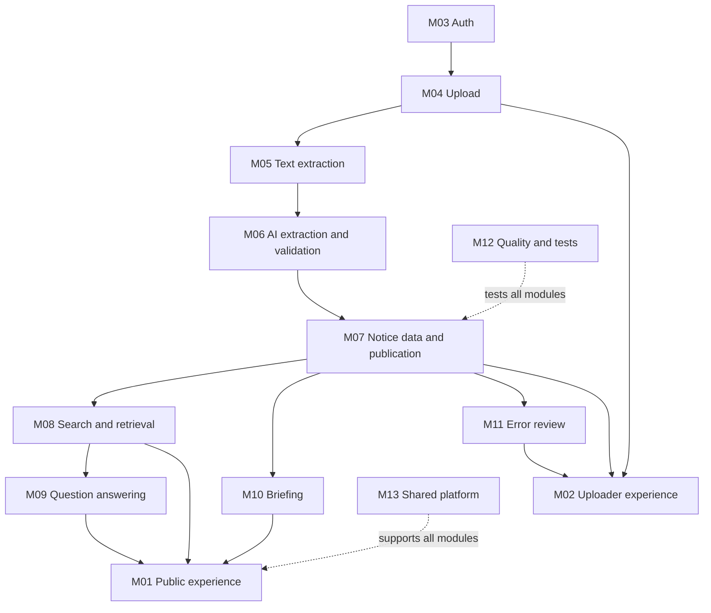

# MODULES.md

**Project:** CAI Campus Intelligence  
**Version:** 1.0  
**Status:** Team implementation guide  
**Audience:** Contributors and AI coding agents  
**Last updated:** 12 November 2026

**Related documents:** `PRD.md`, `TECH_STACK.md`, `SYSTEM_ARCHITECTURE.md`, `DATABASE_SCHEMA.md`, `API_CONTRACTS.md`, `DEVELOPMENT_OWNERSHIP.md`, `PHASE.md`

> These are logical work areas, not a claim that matching folders or services already exist. Inspect the repository before creating, moving, or renaming code.

---

## 1. Why modules exist

The project has multiple connected responsibilities: public screens, uploader screens, file processing, AI extraction, notice storage, search, question answering, and testing.

Without clear boundaries:
- the same behavior may be implemented more than once;
- frontend and backend data shapes may drift;
- changes can break another contributor's work unexpectedly;
- AI coding tools may make broad or conflicting edits.

This guide defines what each module is responsible for, what it must not own, how it connects to other modules, and how it can be tested.

The purpose is to make work understandable and parallelizable for a team with mixed technical experience. Contributors should focus on one bounded task at a time rather than trying to understand the entire codebase before making progress.

## 2. How contributors use this guide

For each task:

1. Read the relevant project documents.
2. Identify the module and its current accountable owner.
3. Read the module's purpose, boundaries, dependencies, and acceptance criteria.
4. Inspect the existing repository before editing.
5. Check `API_CONTRACTS.md` and `DATABASE_SCHEMA.md` before changing shared data shapes.
6. Work from a GitHub issue with a clear outcome.
7. Use a feature branch.
8. Test the change and describe what was tested.
9. Open a pull request and identify any cross-module impact.
10. Update documentation when an agreed interface or responsibility changes.

Do not create a new module, folder, service, or abstraction just because a task is difficult. First check whether it belongs in an existing module.

## 3. System module map

| ID | Module | Main responsibility | Primary accountable owner |
|---|---|---|---|
| M01 | Public Experience | Public home, filters, notice list and detail | P3 |
| M02 | Uploader Experience | Login-facing upload and review interface | P4 |
| M03 | Authentication & Authorization | Verify identity and enforce uploader permissions | Project Lead |
| M04 | Upload & File Management | Validate and store original notice files | Project Lead |
| M05 | Text Extraction & OCR | Extract page-aware text; limited OCR if supported | Project Lead |
| M06 | AI Extraction & Validation | Gemini-assisted extraction and backend validation | Project Lead |
| M07 | Notice Data & Publication | Persist notice records and manage publication lifecycle | Project Lead |
| M08 | Search & Retrieval | Keyword search and relevant passage retrieval | P2 |
| M09 | Question Answering | Evidence-grounded answers and citations | P2, coordinated with Project Lead |
| M10 | Briefing & Notice Discovery | Build the home briefing from published notice data | Project Lead/backend, with P3 UI |
| M11 | Error Reporting & Review Support | Public reports and uploader review workflow | P4 UI; backend enforcement by Project Lead |
| M12 | Quality & Test Assets | Test notices, expected outputs, tests and quality evidence | P1 |
| M13 | Shared Platform & Integration | Configuration, shared types, logging, integration and deployment | Project Lead |

A primary owner is accountable for coordination and progress. It does not mean that only that person may contribute.

## 4. Module definitions

### M01 — Public Experience

**Purpose:** Let students, faculty, and staff discover published notices without creating an account.

**Owns**
- Home/briefing presentation.
- Audience and category selectors.
- Public notice list and detail screens.
- Search and Ask interface presentation.
- Citation and source-link presentation.
- Loading, empty, error, and responsive states.

**Does not own**
- Database queries or privileged writes.
- Gemini calls.
- Publication decisions.
- Backend authorization.
- Search ranking/retrieval logic.

**Inputs**
- Briefing API response.
- Public filter options.
- Published notice list/detail responses.
- Search results.
- Ask answers and citations.

**Outputs**
- Selected filters and search queries.
- Ask question requests.
- Public error reports, if the report UI is included.

**Dependencies:** `API_CONTRACTS.md`, M08, M09, M10, M13.

**Owner:** P3.

**Acceptance criteria**
- Public pages work without login.
- Only published public notices are displayed.
- Audience/category filters follow the contract.
- Notice detail shows available source references.
- Ask citations are visible and traceable.
- Loading, empty, error, and mobile states are handled.
- No privileged key or direct Gemini call exists in browser code.

**Tests**
- Notice card, filter, and detail component tests.
- Loading/empty/error state tests.
- Public API integration tests.
- Verify held/withdrawn notices are not rendered.

### M02 — Uploader Experience

**Purpose:** Provide an authorized interface for uploading notices and handling processing outcomes.

**Owns**
- Uploader navigation and screen layout.
- Sign-in/session presentation and protected-route experience.
- Single/bulk file selection UI.
- Upload progress and per-file outcomes.
- Processing status display.
- Review queue and review detail.
- Notice management list for finding and withdrawing notices.
- Error-report list with resolve/dismiss presentation (see M11).
- Correction forms, relationship confirm/reject controls, and publish/retry/withdraw controls.

**Does not own**
- Actual permission enforcement.
- Backend file validation or storage.
- OCR, extraction, or AI processing.
- Direct privileged database writes.
- Rules that determine publication eligibility.

**Inputs:** Authentication/session state, upload responses, processing status, review queue, review details, validation warnings, allowed actions.

**Outputs:** Upload requests, correction requests, relationship confirm/reject requests, publish/retry/withdraw requests, report-resolution requests (see M11).

**Dependencies:** M03, M04, M07, M11, M13, API contract.

**Owner:** P4.

**Acceptance criteria**
- Protected screens require a session.
- Accepted upload is not shown as published.
- Per-file success/rejection/processing states are clear.
- Review warnings and evidence are visible.
- Consequential actions require confirmation.
- Permission failures are handled safely.
- No service-role or Gemini key is included in browser code.

**Tests**
- Protected-route behavior.
- File selection and upload response handling.
- Review queue loading/empty/error states.
- Correction form validation.
- Confirmation and error behavior for publish/retry/withdraw.

### M03 — Authentication & Authorization

**Purpose:** Establish who is making a request and whether they may perform it.

**Owns**
- Backend token verification.
- Uploader/admin permission lookup.
- Protected route dependencies or middleware.
- Consistent unauthorized/forbidden responses.
- Supabase Auth integration.

**Does not own**
- Frontend visual design.
- Notice extraction or search.
- Frontend-only role checks as a security mechanism.

**Inputs:** Access token, profile/role data, requested action, resource identifier.

**Outputs:** Verified backend identity, authorization decision, safe `401`/`403` responses.

**Dependencies:** Supabase Auth, `profiles` schema, backend environment configuration.

**Owner:** Project Lead.

**Acceptance criteria**
- Public read routes work without login.
- Protected actions require a valid identity and suitable role.
- A signed-in user with no `profiles` record is rejected with `403`.
- Every protected route checks authorization server-side.
- Invalid/expired tokens fail safely.
- Service-role credentials remain backend-only.

**Tests**
- Unauthenticated protected-route request.
- Authenticated non-uploader request.
- Signed-in user with no `profiles` record.
- Authorized uploader request.
- Invalid/expired token.
- Attempts to access another user's protected workflow data.

### M04 — Upload & File Management

**Purpose:** Receive manual notice uploads, validate files, and preserve originals.

**Owns**
- Upload endpoint behavior.
- File type/size validation.
- Safe storage naming/path decisions.
- Private storage integration.
- Notice and processing record creation after successful storage.
- Per-file accepted/rejected response.

**Does not own**
- Automatic website scraping/fetching.
- AI extraction or publication decisions.
- File-picker UI.
- Public search.

**Inputs:** Files, authorized uploader identity, approved configuration.

**Outputs:** Private original storage reference, notice ID, processing state, accepted/rejected outcome.

**Dependencies:** M03, Supabase Storage, database notice/processing records, M05.

**Owner:** Project Lead.

**Acceptance criteria**
- Only authorized uploaders can upload.
- Backend validates file type and size.
- Original is stored before acceptance is reported.
- Storage failure does not produce false success.
- Originals are not overwritten by corrections.
- No automatic college-site ingestion is added to the MVP.

**Tests**
- Valid PDF.
- Supported image if enabled.
- Unsupported/oversized/empty/malformed file.
- Storage failure.
- Unauthorized upload.
- Duplicate behavior when defined.

### M05 — Text Extraction & OCR

**Purpose:** Extract source text while preserving page identity.

**Owns**
- Digital PDF text extraction.
- Page-aware output.
- Detection of pages with little/no extractable text.
- Limited OCR only if configured and supported.
- Extraction error reporting.

**Does not own**
- AI interpretation.
- Notice publication.
- Frontend rendering.
- Search ranking.

**Inputs:** Stored original, file metadata, extraction configuration.

**Outputs:** Page-aware text, page count, extraction metadata, success/failure state, OCR output if supported.

**Dependencies:** M04, PyMuPDF, optional approved Gemini multimodal path.

**Owner:** Project Lead.

**Acceptance criteria**
- Page boundaries are preserved where possible.
- Poor/empty extraction is detected.
- Errors are recorded.
- Original remains available.
- Downstream modules receive a consistent structure.

**Tests**
- Text PDF.
- Multi-page PDF.
- Scanned/image-only PDF.
- Mixed selectable/scanned pages.
- Image file if supported.
- Empty/corrupt PDF.
- Page-number mapping.

**Boundary:** OCR is best-effort pilot support, not a guarantee. If unavailable or uncertain, the notice is held for review.

### M06 — AI Extraction & Validation

**Purpose:** Convert extracted source text into structured notice information and identify uncertainty.

**Owns**
- Backend Gemini extraction orchestration.
- Structured extraction schema and prompt.
- Summary generation.
- Supported metadata, audience, dates, action items, and relationship candidates.
- Field source/evidence references.
- Backend validation and hold reasons.
- AI processing error records.

**Does not own**
- Gemini calls from browser code.
- Treating model output as truth.
- Replacing the original.
- Human review decisions.
- Public UI or search ranking.

**Inputs:** Page-aware text, approved schema/vocabularies, backend Gemini configuration, validation rules.

**Outputs:** Structured extraction candidate, summary, source references, validation issues, proposed outcome.

**Dependencies:** M05, Gemini backend integration, database schema, M07.

**Owner:** Project Lead.

**Acceptance criteria**
- Gemini is called only from backend.
- Output is schema-validated.
- Unsupported or incomplete output is not silently published.
- Critical source references are retained where available.
- Failed calls and validation issues are recorded.
- Uncertain cases enter review.

**Tests**
- Expected extraction on representative notices.
- Missing or ambiguous audience/date.
- Conflicting dates.
- Malformed model output.
- Provider timeout/rate limit.
- Unsupported field detection.
- Repeat processing behavior.

### M07 — Notice Data & Publication

**Purpose:** Maintain canonical notice records and determine what may become public.

**Owns**
- Notice persistence.
- Audience/date/action/relationship records.
- Processing/publication/relationship state.
- Automatic publication after required checks pass.
- Human correction and audit history.
- Relationship confirm/reject handling and the resulting relationship-status updates.
- Withdrawal and public visibility rules.

**Does not own**
- Direct browser writes to privileged tables.
- PDF extraction.
- Search ranking.
- Review-screen design.

**Inputs:** Upload/storage references, extraction candidates, validation outcomes, corrections, authorized publish/withdraw actions, authorized relationship confirm/reject actions.

**Outputs:** Persisted notice records, lifecycle states, public-safe notice representations, audit history.

**Dependencies:** PostgreSQL schema, M03, M04, M06; consumed by M08 and M10.

**Owner:** Project Lead.

**Acceptance criteria**
- Only eligible published notices are exposed publicly.
- Held and withdrawn notices are excluded from public APIs and retrieval.
- Corrections are auditable.
- Original source is preserved.
- State transitions are validated server-side.
- Database policies support the intended access boundary.

**Tests**
- Notice creation and update.
- Automatic publish eligibility.
- Held/review/publish flow.
- Withdrawal and public exclusion.
- Audit trail.
- RLS/grant behavior.

### M08 — Search & Retrieval

**Purpose:** Find relevant published notices and source passages.

**Owns**
- Search request handling.
- PostgreSQL keyword/full-text search.
- Audience/category filters.
- Retrieval of source chunks and page references.
- Ranking and response formatting.

**Does not own**
- Public search UI.
- Browser-side Gemini credentials.
- Publication rules.
- Source notice editing.
- Unsupported answer generation.

**Inputs:** Query, filters, published notice records, page-aware chunks.

**Outputs:** Ranked notice results, excerpts, notice IDs, page references, retrieval evidence for M09.

**Dependencies:** M07, `notice_chunks`, extraction output, API contract.

**Owner:** P2.

**Acceptance criteria**
- Only published eligible notices are searchable.
- Filters work consistently.
- Results link to the correct notice.
- Excerpts/page references are preserved.
- Empty results are handled.
- Implementation uses keyword search as the baseline.

**Tests**
- Exact keyword/reference match.
- Phrase search.
- Audience/category filters.
- No-result query.
- Held/withdrawn exclusion.
- Excerpt/page mapping.

**Boundary:** Semantic/vector retrieval is not a baseline dependency. Add it only after a separate decision and schema/API update.

### M09 — Question Answering

**Purpose:** Answer public questions using retrieved published notice evidence.

**Owns**
- Ask request validation.
- Coordination with M08 retrieval.
- Backend Gemini Q&A orchestration.
- Citation construction and validation.
- Not-found/uncertainty response.

**Does not own**
- Browser-side Gemini calls.
- Retrieval from held/unpublished notices.
- Invented facts or citations.
- Public chat UI.
- Editing original notices.

**Inputs:** Question, optional audience, retrieved source passages, backend Gemini configuration.

**Outputs:** Grounded answer, answer status, citations with notice and page/excerpt where available.

**Dependencies:** M08, M07, Gemini backend integration, API contract.

**Owner:** P2, coordinated with Project Lead.

**Acceptance criteria**
- Answers use only retrieved published evidence.
- Citations refer to actual retrieved passages.
- Unsupported questions return not-found/uncertain.
- Conflicting evidence is not silently guessed away.
- Provider failures are handled safely.
- No secret is sent to the browser.

**Tests**
- Answerable question.
- Unanswerable question.
- Conflicting source passages.
- Citation validity.
- Audience filtering.
- Gemini timeout/rate limit.

### M10 — Briefing & Notice Discovery

**Purpose:** Assemble the public home briefing from stored published notice data.

**Owns**
- Backend query/aggregation for this week, coming up, recently posted, action items, and recent changes.
- Audience eligibility logic.
- Exclusion of cancelled/superseded items where appropriate.
- Stable briefing response shape.

**Does not own**
- Home page visual design.
- Live AI generation for the home page.
- Notice extraction.
- Search ranking.

**Inputs:** Published notices, dates, targets, action items, confirmed relationships, selected audience.

**Outputs:** Briefing API response grouped by section.

**Dependencies:** M07, database indexes/query patterns, API contract.

**Owner:** Project Lead/backend; P3 owns presentation.

**Acceptance criteria**
- Briefing is derived from stored data.
- Home page does not wait for Gemini.
- Audience selection is applied consistently.
- Upcoming sections exclude cancelled/superseded deadlines.
- Empty sections return cleanly.

**Tests**
- Date-window behavior.
- Audience matching.
- No upcoming dates.
- Changed notice behavior.
- Public visibility filtering.

### M11 — Error Reporting & Review Support

**Purpose:** Let viewers flag possible errors and route those reports to authorized reviewers.

**Owns**
- Backend report creation and validation.
- Abuse/rate-limit integration.
- Review/report state transitions.
- Uploader-facing report presentation and resolution interaction (P4).

**Does not own**
- Automatically changing a notice because a report was submitted.
- Public moderation decisions outside the agreed workflow.
- Direct anonymous database writes.

**Inputs:** Public report request, notice ID, issue type/description, authorized reviewer action.

**Outputs:** Report record, review queue item, resolved/dismissed state.

**Dependencies:** M03, M07, `error_reports` schema, API contract.

**Owner:** P4 for UI; Project Lead for backend.

**Acceptance criteria**
- Only publicly visible notices can be reported.
- Reports are rate-limited and validated.
- A report does not directly alter a notice.
- Reports appear in the authorized review workflow.
- Resolution is recorded with timestamp and optional resolution note.

**Tests**
- Valid report.
- Invalid notice ID.
- Rate limit.
- Oversized description.
- Resolve/dismiss authorization and resolution note persistence.
- Confirm report submission does not change notice state.

### M12 — Quality & Test Assets

**Purpose:** Provide evidence that product behavior is correct and stable.

**Owns**
- Representative test notices that may be used lawfully.
- Expected extraction values and source pages.
- Manual test cases and automated test coordination.
- Defect reports and regression checks.
- Demo validation checklist and test results.

**Does not own**
- Silently redefining product requirements.
- Making production publication decisions.
- Changing shared contracts without owner agreement.

**Inputs:** PRD acceptance criteria, sample notices, expected outputs, integrated application.

**Outputs:** Test fixtures, test cases, defect reports, test summaries, demo checklist.

**Dependencies:** All modules; especially M04–M09.

**Owner:** P1.

**Acceptance criteria**
- Test set covers varied document shapes and edge cases.
- Expected values cite source pages.
- Defects are reproducible and clearly described.
- Core workflows are regression-tested.
- Accuracy claims are based on measured results only.

**Tests**
- Maintain and run the agreed test suite.
- Verify extraction against expected values.
- Verify access boundaries, search, Ask, and lifecycle transitions.
- Retest fixed defects.

### M13 — Shared Platform & Integration

**Purpose:** Keep the application runnable and its modules connected.

**Owns**
- Shared environment/configuration conventions.
- Common API client/types and shared frontend foundations in coordination with P3/P4.
- Logging and safe error conventions.
- CORS and environment setup.
- Integration workflow and deployment coordination.
- Cross-module compatibility checks.

**Does not own**
- Every feature implementation.
- Unreviewed architectural changes.
- Secret values committed to the repository.

**Inputs:** Approved technical stack, module interfaces, environment configuration, merged feature branches.

**Outputs:** Runnable development environment, shared utilities, integration fixes, deployment configuration.

**Dependencies:** All modules.

**Owner:** Project Lead.

**Acceptance criteria**
- Contributors can run the project using documented steps.
- Environment variables are documented with safe placeholders.
- Shared types match the API contract.
- Integration changes are coordinated.
- No secret is committed.
- The application can be built and tested consistently.

**Tests**
- Clean setup/build check.
- Frontend/backend health check.
- Environment validation.
- Integration smoke tests.
- Deployment smoke tests.

## 5. Module dependency overview

The diagram shows major dependencies, not a required order for every task. Independent UI work can use agreed mock responses while backend work proceeds.

## 6. Shared boundaries that must remain stable

### 6.1 API boundary
- Frontend modules use `API_CONTRACTS.md`.
- Do not create ad hoc endpoint shapes inside individual components.
- A contract change must be coordinated with every affected consumer.

### 6.2 Database boundary
- Backend modules use the agreed schema and migrations.
- Frontend code must not write privileged notice or processing records directly.
- Schema changes require migration, API, and test updates.

### 6.3 AI boundary
- Gemini calls happen on the backend.
- Model output is untrusted until validated.
- AI output cannot set permissions or bypass publication checks.

### 6.4 Publication boundary
- M06 validates extraction candidates.
- M07 owns persistence and publication state.
- M08/M09/M10 consume only eligible published data for public features.

### 6.5 Frontend boundary
- P3 owns the public experience.
- P4 owns the uploader experience.
- Shared routing, layout, design tokens, and components must be coordinated rather than independently duplicated.

## 7. How to work in parallel

Parallel development is appropriate when the shared interface is understood.

Example:
- P3 can build public screens with mock briefing/notice responses.
- P4 can build upload and review screens with mock processing states.
- P2 can prepare search test cases and retrieval logic against the agreed chunk/response shape.
- P1 can assemble sample notices and expected extraction results.
- The Project Lead can establish backend foundations and processing pipeline.

Before integration:
1. confirm mock data matches the API contract;
2. confirm field names/status values match the database schema;
3. identify any contract changes;
4. run module tests;
5. test the connected workflow.

Do not let parallel work silently invent incompatible interfaces.

## 8. AI coding agent instructions for module tasks

An AI coding agent working on a module must:

1. Read the relevant module section and its linked project documents.
2. Inspect the repository, current branch, existing code, migrations, tests, and configuration before editing.
3. Confirm the task's GitHub issue and module owner.
4. Keep changes within the assigned module unless an interface change is explicitly approved.
5. Reuse existing patterns and dependencies where practical.
6. Never invent a route, table, field, secret, or provider configuration.
7. Keep secrets server-side and preserve public/private boundaries.
8. Add or update tests for changed behavior.
9. Update the relevant documentation if a contract or decision changes.
10. Report files changed, behavior implemented, tests run, assumptions, and remaining work.

A planned module or file in this guide does not prove it exists in the repository.

## 9. Ownership is flexible

- A module may have multiple contributors.
- One person remains accountable for each module at a given time.
- Ownership can change as availability and skills change.
- Reassigning ownership does not automatically change the module interface.
- Interface changes must be coordinated with affected module owners.
- Update `DEVELOPMENT_OWNERSHIP.md` and relevant GitHub issues when assignments change.

The initial role mapping is in `DEVELOPMENT_OWNERSHIP.md`:
- Project Lead: technical direction, backend foundation, processing pipeline and integration.
- P1: quality and test assets.
- P2: search and question answering.
- P3: public frontend.
- P4: uploader/admin frontend.

## 10. Module readiness checklist

A module is ready to be assigned when:
- [ ] Its purpose and boundaries are understood.
- [ ] One accountable owner is assigned.
- [ ] Dependencies are identified.
- [ ] Inputs and outputs are known.
- [ ] Required API/database contracts are available.
- [ ] A GitHub issue describes the outcome and acceptance criteria.
- [ ] A test approach is identified.
- [ ] The contributor has repository/environment access.

A module is complete when:
- [ ] Acceptance criteria are met.
- [ ] Relevant tests pass.
- [ ] No known unauthorized data exposure remains.
- [ ] Integration with dependent modules is verified.
- [ ] Documentation reflects the implementation.
- [ ] The pull request is reviewed and merged.

## 11. Out of scope

This document does not define:
- exact individual GitHub issue estimates or sprint dates;
- final repository folder structure;
- exact implementation classes/functions;
- production credentials;
- unresolved product decisions;
- permanent individual ownership.

Those belong in `PHASE.md`, `GITHUB_ROADMAP.md`, `CODING_GUIDELINES.md`, environment documentation, and decision records.

## 12. Maintenance

The Project Lead maintains this document with input from module owners. Update it when module boundaries, dependencies, acceptance criteria, or ownership responsibilities change.

**End of document.**
