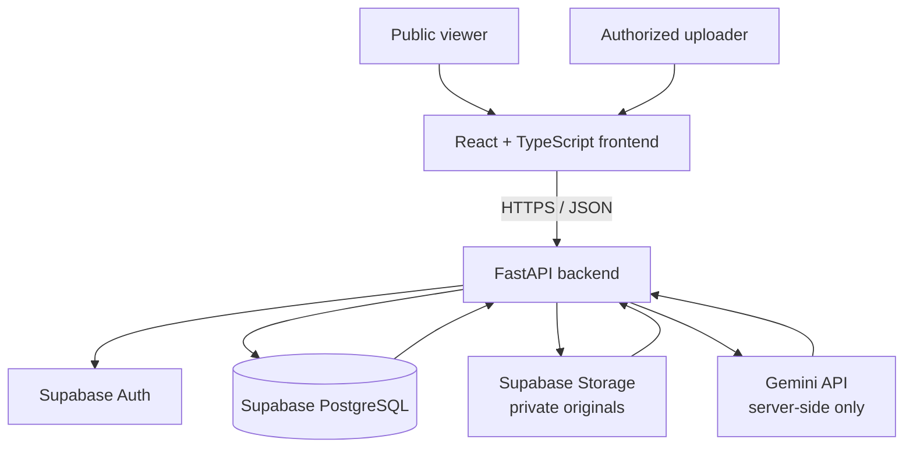
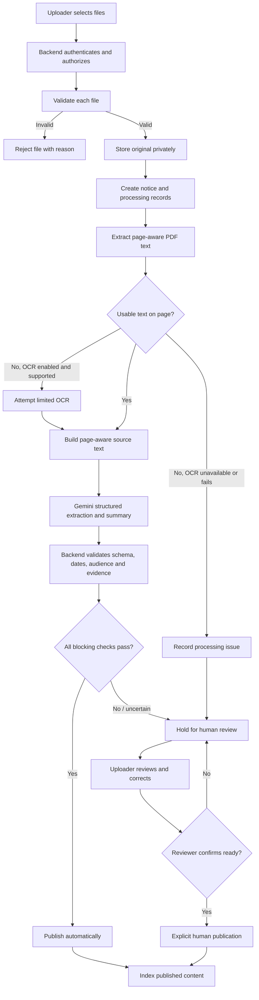

# CAI Campus Intelligence — System Architecture

**Version:** 1.0  
**Status:** Implementation baseline  
**Audience:** Project team and AI coding agents  
**Decision authority:** Project Lead / Technical Lead, with product scope governed by `PRD.md`  
**Last updated:** 12 November 2026

> This document describes the intended MVP architecture. It is not proof that the components, routes, migrations, or deployment already exist. Before changing code, inspect the current repository and compare the implementation with these decisions.

---

## 1. Purpose and system summary

CAI Campus Intelligence is a public notice-discovery application. Authorized uploaders manually submit official college notices. The backend preserves each original file, extracts page-aware content, uses Gemini for assisted extraction and summaries, validates the result, and publishes eligible notices. Uncertain or failed notices are held for human review.

Public viewers can browse, filter, search, and ask questions about published notices without signing in. Answers must be grounded in published notice evidence and cite the relevant notice and page where available.

**The original notice is authoritative.** Structured fields, summaries, and AI-generated answers are assistive representations and must remain traceable to source material.

### 1.1 MVP boundaries

- Notice intake is manual; there is no automatic college-site fetching or scraping.
- The application uses one frontend codebase and one backend application for the MVP.
- Public reading is unauthenticated; notice-management operations require authenticated and authorized uploaders.
- Original files are stored privately and preserved unchanged.
- Passing notices may be published automatically after backend validation.
- Uncertain or failed notices are held for review.
- Keyword search is the baseline.
- OCR is limited best-effort support for supported scanned pages; unsupported or uncertain cases are held.
- Semantic/vector search is not a prerequisite for the baseline MVP.
- Public Ask uses only retrieved evidence from published notices.
- The system does not replace official college communication.

## 2. Architectural style

Use a **modular monolith**.

The diagram shows logical dependencies, not a final deployment topology.

### 2.1 Main deployable parts

1. **Frontend:** one React + TypeScript + Vite application, with public and uploader route areas.
2. **Backend:** one FastAPI application, internally separated into API, authentication, services, and processing modules.
3. **Database:** one Supabase PostgreSQL database.
4. **File storage:** one private Supabase Storage bucket or an equivalent approved private storage arrangement.
5. **Authentication:** Supabase Auth for uploader identity.
6. **AI provider:** Gemini called only by backend services.

Do not split these into microservices or add a separate queue, cache, or search platform unless actual pilot requirements justify it.

## 3. Components and responsibilities

| Component | Owns | Must not |
|---|---|---|
| Public frontend | Home briefing, audience/category filters, notice lists/details, search and Ask presentation, error-report form | Call Gemini directly, expose privileged credentials, decide publication eligibility |
| Uploader frontend | Sign-in presentation, file selection/upload, processing status, review queue, correction and management forms | Enforce security by UI visibility alone, write privileged data directly |
| FastAPI API layer | HTTP validation, authentication integration, authorization checks, response shaping, rate limits | Trust client-supplied roles or expose secrets |
| Notice-processing pipeline | File validation, text extraction, optional OCR, Gemini orchestration, validation, publication outcome | Publish based only on unvalidated model output |
| Notice/domain services | Notice lifecycle, audience/date/action relationships, review and withdrawal rules | Allow unrelated modules to bypass domain rules |
| Search and Ask services | Keyword retrieval, filters, evidence selection, grounded answer generation and citation checks | Retrieve held/unpublished records for public requests |
| Supabase Auth | Authenticate uploader identity | Decide application permissions by itself |
| PostgreSQL | Persist notice records, state, source evidence, relationships, chunks, edits and reports | Expose internal records to public clients |
| Supabase Storage | Preserve original files and provide controlled access | Treat a stored file as automatically public |
| Gemini | Assist with extraction, summaries, and evidence-grounded answers | Make authorization or final publication decisions |
| Test assets | Representative source notices, expected fields, test cases and regression fixtures | Become production notice data by accident |

## 4. Trust boundaries and request paths

### 4.1 Public request path

1. A viewer uses the public frontend without signing in.
2. The frontend calls a public FastAPI endpoint over HTTPS.
3. The backend validates query parameters and applies rate limits where relevant.
4. The backend queries only published and public-safe records.
5. The backend returns a deliberately shaped response; internal fields and processing metadata are omitted.
6. The frontend renders the response and source links.

Public endpoints must not reveal whether an inaccessible held/private notice exists. Return a not-found response for a record that is absent or not publicly visible.

### 4.2 Uploader request path

1. An uploader signs in through the approved Supabase Auth client flow.
2. The frontend receives an access token/session from Supabase Auth.
3. The frontend sends the token with protected backend requests.
4. The backend verifies the token and resolves the account's application role.
5. The backend checks that the role permits the requested operation.
6. The backend performs the operation using controlled server-side database/storage access.
7. The backend returns a safe response and records consequential actions.

A valid login is not sufficient authorization. Every protected operation must perform a server-side permission check.

### 4.3 External service boundary

- The browser communicates with the application backend and the approved authentication flow.
- The backend communicates with Supabase services and Gemini.
- Gemini credentials and Supabase service-role credentials exist only in backend configuration.
- Gemini must never receive a request to decide whether a user is authorized or whether it may publish a record.

## 5. Notice processing lifecycle

### 5.1 End-to-end flow

A failure path must preserve the original file and enough processing history to explain what happened. A rejected file is not represented as an accepted notice.

### 5.2 Step responsibilities

**Step 1 — Receive and validate**
- Verify uploader authentication and authorization.
- Check allowed file type, file signature where practical, file size, and batch limits.
- Validate each file independently.
- Return clear rejection reasons.
- Do not report an upload as accepted until the original has been safely stored and the corresponding database state has been created.

**Step 2 — Preserve original**
- Store the original in a private bucket.
- Save a stable storage path and file metadata.
- Do not overwrite the original when a field is corrected.
- Public access is granted only after publication through the approved controlled-access mechanism.

**Step 3 — Create processing state**
- Create a notice record and initial processing record.
- Persist processing status before starting asynchronous work.
- Keep processing status separate from publication status and relationship status.

**Step 4 — Extract text**
- Use PyMuPDF for digital PDF text extraction.
- Process page by page and retain page numbers.
- Detect pages with little/no selectable text.
- Record extraction errors without damaging the source file.

**Step 5 — Limited OCR**
- Attempt OCR only when the page lacks usable text and the configured Gemini input path supports the file/page.
- Enforce configured file/page and provider usage limits.
- Preserve page mapping.
- Treat OCR text as untrusted extracted content that requires validation.
- If OCR is unavailable, fails, or is ambiguous, hold the notice or route it to review. Do not fabricate missing text.

**Step 6 — AI-assisted extraction**
- Send page-aware source text and a constrained extraction instruction to Gemini.
- Request structured output for the agreed notice fields.
- Include source-page/passage references for key fields.
- Treat the response as untrusted input; it is not ready for database persistence or publication without validation.

**Step 7 — Backend validation**
- Validate response structure and data types.
- Validate controlled category and audience values.
- Parse and validate dates; preserve issue date, event date, and deadline separately.
- Verify critical extracted fields against source passages/page references.
- Do not infer an audience that the source does not state.
- Detect missing, conflicting, or ambiguous critical information.
- Treat model-reported confidence as supporting metadata, not the sole publication gate.
- Route uncertain relationship detection to review.

**Step 8 — Publish or hold**
- Publish automatically only when all applicable blocking checks pass.
- Otherwise set publication state to held and record clear reasons.
- Human publication of a held notice is an explicit authorized action after review.
- A notice's successful processing does not by itself mean it is public.

**Step 9 — Index**
- Index only content eligible for public search.
- Store page-aware chunks and metadata needed for excerpts/citations.
- Use PostgreSQL full-text search for the baseline.
- Semantic/vector indexing is optional and requires a separate approved decision.

## 6. State model

Do not create one combined status field for the entire notice workflow. Three separate dimensions are used.

### 6.1 Processing status

Describes the pipeline execution:

- `pending`
- `processing`
- `completed`
- `failed`

A processing status does not determine public visibility.

### 6.2 Publication status

Describes whether the notice is publicly available:

- `held`
- `published`
- `withdrawn`

A notice may have `processing_status = completed` and `publication_status = held` if processing completed but validation requires human review.

### 6.3 Relationship status

Describes the notice's current relationship/lifecycle state:

- `current`
- `superseded`
- `amended`
- `extended`
- `cancelled`

The relationship table records which earlier and later notices are connected and why. The status field is a convenient notice-level representation; it does not replace the relationship record.

The status transition rules are defined in `DATABASE_SCHEMA.md` §5.7; route behaviour and error codes are in `API_CONTRACTS.md`. A status transition must be validated by the backend.

## 7. Human review and notice lifecycle

### 7.1 Review

The uploader review interface should show:
- the original file or a safe preview;
- extracted fields;
- validation warnings and hold reason;
- supporting source pages/passages;
- current processing/publication/relationship state;
- available actions for the uploader's permission level.

### 7.2 Corrections

- Human corrections update structured fields, not the original file.
- Record the actor, timestamp, field changed, previous value, new value, and optional correction note.
- Mark corrected fields as human-corrected.
- Revalidate the notice after corrections.
- Do not silently publish after a correction; use the explicit review/publish action for held notices.

### 7.3 Withdrawal

- Withdrawal removes a notice from public lists, briefing, search, and Ask retrieval.
- Preserve the notice, original file, relationships, and audit history according to retention policy.
- Permanent deletion is not a normal notice-management operation in the MVP.

### 7.4 Changed notices

- Prefer explicit reference numbers and clear language in the source.
- Record relationship type, source evidence, and confidence/review metadata.
- If the relationship is uncertain, hold the new notice or relationship for review.
- Do not automatically supersede or cancel an earlier notice based only on topical similarity.
- Keep earlier notices accessible as historical records, subject to their publication/withdrawal state.
- Exclude cancelled and superseded deadlines from current upcoming/action views.

### 7.5 Error reports

- Public visitors can submit structured error reports on published notices (`API_CONTRACTS.md` §7.8).
- Reports record notice ID, issue type, description, and status (`open`, `resolved`, `dismissed`).
- Authorized uploaders review open reports, apply corrections via the notice correction workflow if required, and record resolution/dismissal decisions with an optional resolution note (`DATABASE_SCHEMA.md` §4, `API_CONTRACTS.md` §8.9).

## 8. Data architecture

`DATABASE_SCHEMA.md` is the authoritative detailed source for tables, columns, constraints, indexes, and database policies. This section describes logical data groups.

| Data group | Responsibility | Current schema concepts |
|---|---|---|
| Identity and organization | Uploader profile, application role, departments | `profiles`, `departments` |
| Notice core | Official notice metadata, source reference, state | `notices` |
| Audience and dates | Notice audience targets, events, deadlines | `notice_targets`, `notice_dates` |
| Actions and relationships | Required actions and links between notices | `action_items`, `notice_relations` |
| Search content | Page-aware extracted text and search index | `notice_chunks` |
| Provenance | Field-to-source page/passage mapping | `field_sources` |
| Processing | AI runs, stage events, errors and retries | `extraction_runs`, `processing_events` |
| Human review | Corrections and public issue reports | `notice_edits`, `error_reports` |

### 8.1 Data integrity requirements

- Keep the original source file immutable.
- Preserve page references for extracted text and citations.
- Keep AI-derived values distinguishable from human corrections.
- Record processing runs and important state transitions.
- Keep processing, publication, and relationship status separate.
- Enforce access through backend authorization, RLS, and effective database grants.
- Ensure public queries exclude held and withdrawn notices and any non-public child data.
- Keep relationship history rather than deleting earlier notices.

### 8.2 Embeddings

Embeddings are not required for baseline keyword search. If semantic search is approved later, choose the model and verify its vector dimension before adding or applying vector columns/indexes. A placeholder dimension must not be treated as a confirmed model decision.

## 9. Search and Ask architecture

### 9.1 Keyword search

1. Receive query and optional audience/category/date filters.
2. Validate and normalize parameters.
3. Query only published and public-safe notice records and page-aware chunks.
4. Apply audience and status filters before returning results.
5. Rank using PostgreSQL full-text search and exact metadata matching where appropriate.
6. Return notice summary, excerpt, page reference, and visible relationship status.

### 9.2 Ask

1. Receive the question and selected audience.
2. Retrieve relevant passages using the approved keyword retrieval layer.
3. Limit evidence to published and public-safe notices.
4. Send the question and retrieved evidence to Gemini.
5. Require a grounded answer and structured citations.
6. Validate every returned citation against the actual retrieved passage set.
7. Return an answer, citations, and an explicit not-found/uncertain status when necessary.

The answer generator must not receive held/unpublished records as evidence for public questions. The backend, not the model, is responsible for access filtering and citation verification.

## 10. Security architecture

### 10.1 Secrets and configuration
- Gemini API key and Supabase service-role key are backend-only.
- Frontend build variables must never contain privileged credentials.
- `.env` and local credential files must be ignored by Git.
- `.env.example` contains placeholder names only.
- Separate development and production credentials where practical.

### 10.2 Authentication and authorization
- Public endpoints do not require a user account.
- Protected routes require a valid Supabase Auth token.
- The backend verifies identity and resolves the application role.
- The backend checks permission for every protected action.
- A user cannot grant themselves uploader/admin permission through request data.
- A signed-in user with no application profile has no role and is not authorized.
- Sign-up is disabled for the pilot; accounts are provisioned through an approved admin process.

### 10.3 Database access
- All application data access goes through the FastAPI backend; the browser does not query application tables directly, so Supabase `anon` and `authenticated` roles hold no direct grants on application tables.
- Enable RLS on every application table exposed through Supabase APIs.
- Define explicit policies for intended access.
- Review effective table grants as well as RLS policies.
- Internal profiles, extraction runs, edits, processing events, and reports must not be publicly readable.
- Public policies must check all related records needed to establish visibility, not only one side of a relationship.
- Use service-role access only from the backend and only where required.

### 10.4 File access
- Store original files in a private bucket.
- A storage path is not itself permission to read a file.
- Grant public access only after the notice is published and only through the approved mechanism.
- Use short-lived signed URLs or backend-mediated downloads; do not expose long-lived privileged URLs.
- Do not expose held notice filenames or storage paths through public endpoints.

### 10.5 Untrusted input
- Validate uploads and handle malformed files safely.
- Treat extracted text and Gemini output as untrusted.
- Escape content in the frontend.
- Ignore instructions embedded in uploaded documents that attempt to change application behavior, prompts, or permissions.
- AI output cannot authorize a user or perform privileged actions.
- Apply rate limits and request-size limits to public endpoints.

## 11. Failure handling and recovery

| Failure | Required behavior |
|---|---|
| Invalid/unsupported file | Reject that file with a clear reason; do not start processing |
| Storage failure | Do not report acceptance; record safe diagnostic state where possible |
| PDF parsing failure | Preserve original; record failure; offer authorized retry/review |
| OCR unavailable or failed | Do not invent text; hold or mark as requiring review |
| Gemini timeout/rate limit | Record stage failure; apply bounded retry/backoff; otherwise hold/retry later |
| Invalid Gemini output | Reject output; record validation issue; hold notice |
| Source evidence mismatch | Hold notice; do not publish |
| Database write failure | Do not report successful publication; retain recoverable state where possible |
| Process restart during task | Detect stale `processing` records and mark retryable/failed through a controlled recovery path |
| Search finds no evidence | Return empty results or a not-found answer; do not guess |
| Unauthorized action | Return 401/403 without disclosing protected data |

Retry behavior must be bounded and idempotent where practical. Retrying must not create duplicate public notices or erase prior processing history.

## 12. Deployment and runtime

The proposed deployment uses:
- static hosting for the React frontend;
- a FastAPI backend service;
- Supabase for PostgreSQL, Auth, and private file storage;
- Gemini as the backend AI provider.

The exact frontend and backend hosting providers remain deployment choices to confirm in `TECH_STACK.md` and the deployment configuration.

Before a pilot release:
- configure environment variables and allowed CORS origins;
- verify the database migrations against a clean test project;
- verify RLS and grants using both public and uploader test identities;
- verify private file access and signed-link expiry;
- test provider timeouts and quota failures;
- test recovery from an interrupted processing job;
- run the product acceptance test set against the deployed application.

## 13. Module boundaries and team collaboration

Modules are logical boundaries, not separate services. Their ownership may be shared or reassigned as the team changes.

The current module guide (`MODULES.md`) defines module IDs and responsibilities. At architecture level, the principal work areas are:

- public experience;
- uploader experience;
- authentication and authorization;
- upload and file management;
- text extraction and limited OCR;
- AI extraction and validation;
- notice data and publication;
- search and retrieval;
- question answering;
- briefing and discovery;
- error reporting and review;
- quality/test assets;
- shared platform and integration.

The ownership document defines current task leads. It must not imply that only one person can contribute to a work area or that a person must retain an assignment permanently.

### Integration contracts

- Frontend modules communicate with the backend through `API_CONTRACTS.md`.
- Pipeline and search modules agree on page-aware text chunk structure and source references.
- Search and Ask use the same audience and publication eligibility rules as public notice browsing.
- Database schema changes are coordinated with backend and frontend consumers.
- A module owner may propose an interface change, but affected contributors must be informed and the relevant contract updated.

## 14. Implementation sequence

The detailed project phases belong in `PHASE.md` and `GITHUB_ROADMAP.md`. At architecture level, the recommended dependency sequence is:

1. Confirm repository structure, local setup, environment configuration, and a runnable frontend/backend skeleton.
2. Establish database migrations, Supabase connection, authentication verification, and RLS/grant tests.
3. Implement manual upload, private original storage, and per-file processing records.
4. Implement digital PDF text extraction and page references.
5. Implement Gemini structured extraction, backend validation, and automatic-publish/hold outcomes.
6. Implement uploader review and correction workflow.
7. Implement public notice listing, detail, and briefing.
8. Implement keyword search and grounded Ask with citation checks.
9. Complete integration, security tests, representative-notice evaluation, and pilot deployment.

This is a dependency guide, not a substitute for the phase plan. Work may overlap when interfaces and dependencies are clear.

## 15. Architecture change process

A proposed change to a shared component, data model, security boundary, external provider, or integration contract must be recorded before implementation.

The proposal should state:
- the problem being solved;
- the affected modules and documents;
- the security/data implications;
- migration or compatibility needs;
- the testing required;
- the decision owner.

Update this architecture and the affected schema/API/stack/phase documents as part of the same coordinated change where practical.

## 16. Related documents

- `PRD.md` — product scope, user journeys, and acceptance criteria.
- `TECH_STACK.md` — technologies, providers, and runtime constraints.
- `DATABASE_SCHEMA.md` — tables, columns, constraints, indexes, and RLS policies.
- `API_CONTRACTS.md` — frontend/backend routes and request/response shapes.
- `MODULES.md` — logical module responsibilities and boundaries.
- `DEVELOPMENT_OWNERSHIP.md` — flexible current team responsibility assignments.
- `PHASE.md` — current phase and completion gates.
- `GITHUB_ROADMAP.md` — task organization and development roadmap.
- `CODING_GUIDELINES.md` — code quality, naming, security, and implementation conventions.
- `GIT_WORKFLOW.md` — branching, commit, pull request, review, and merge workflow.
- `TESTING_STRATEGY.md` — test layers, test assets, AI/OCR evaluation, and bug reporting.
- `AGENTS.md` — instructions for AI coding agents.

**Maintenance rule:** When architecture changes, update this document and every affected contract or implementation guide. Do not allow known differences between the architecture, API, schema, and code to remain undocumented.

**End of document.**
